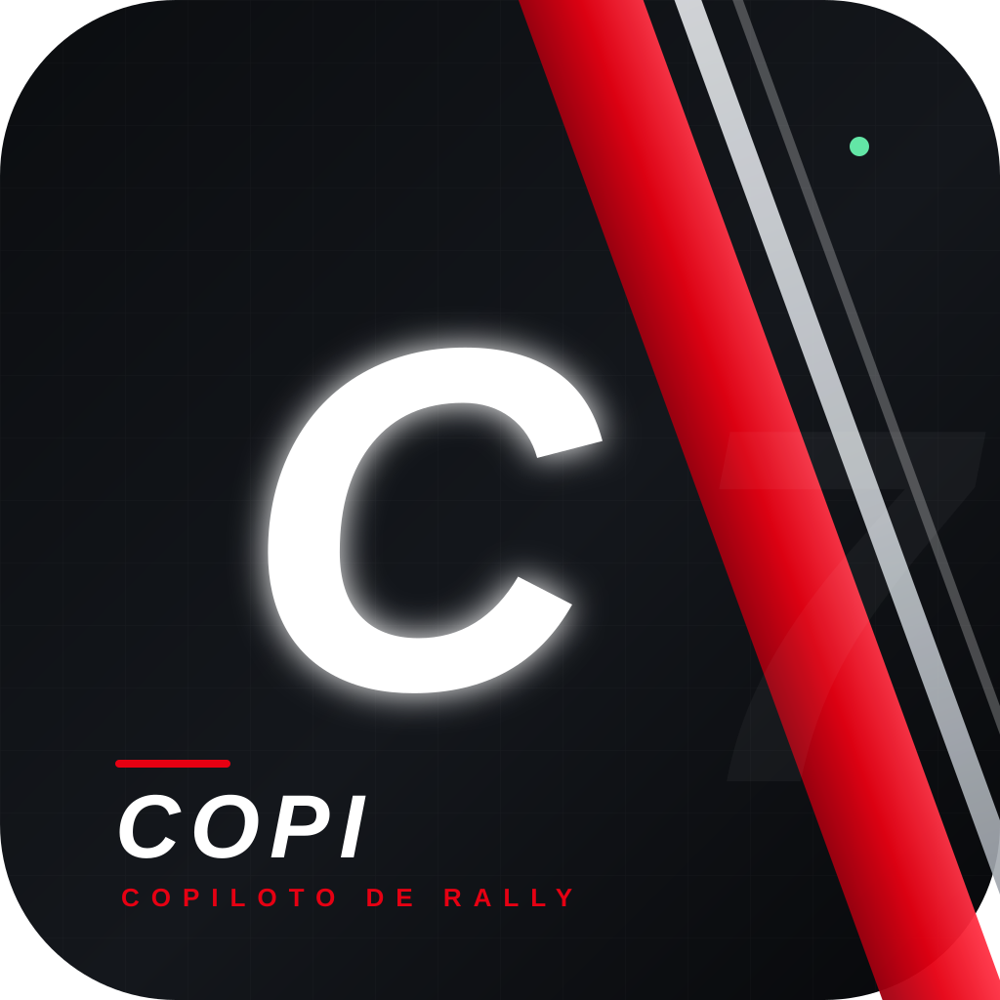
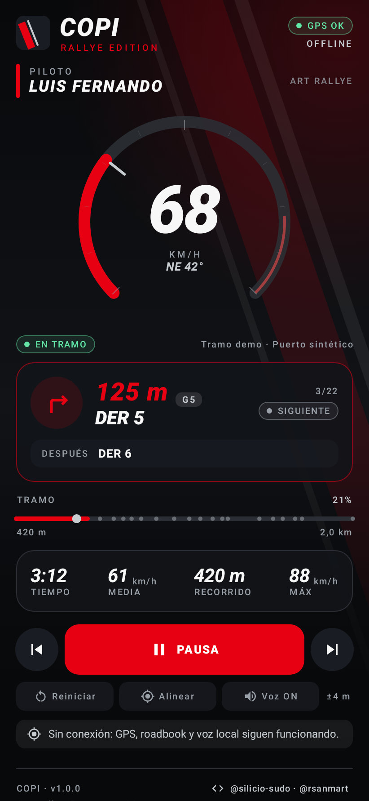
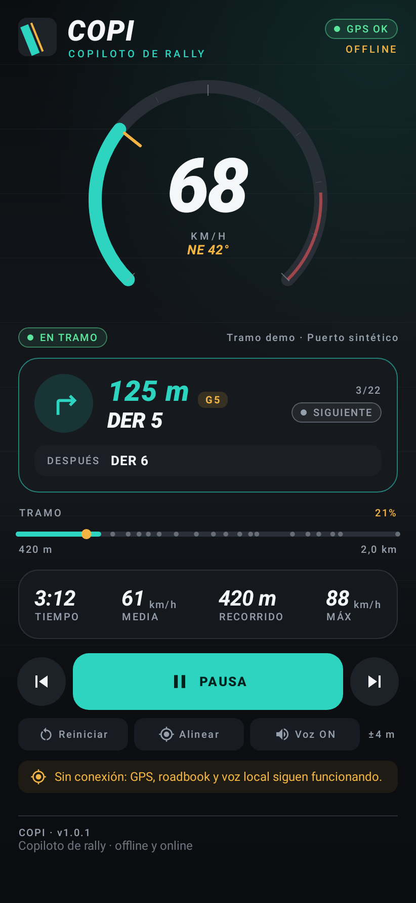
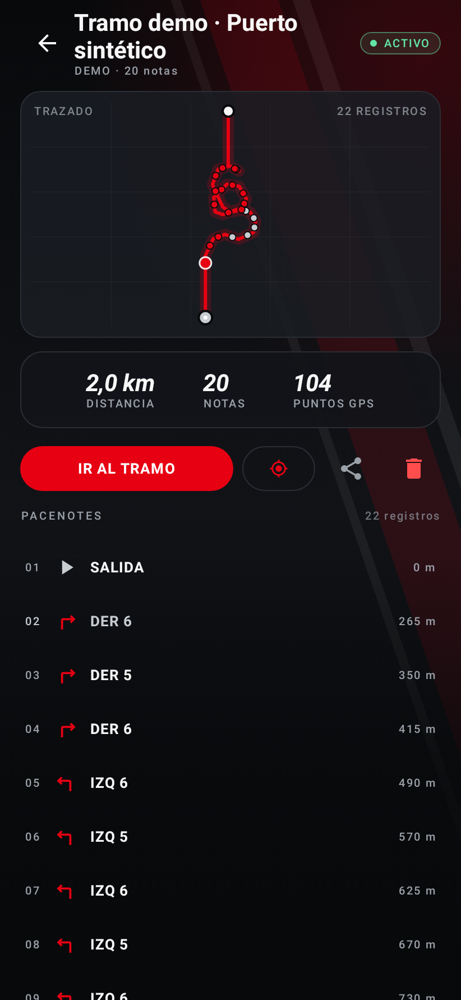
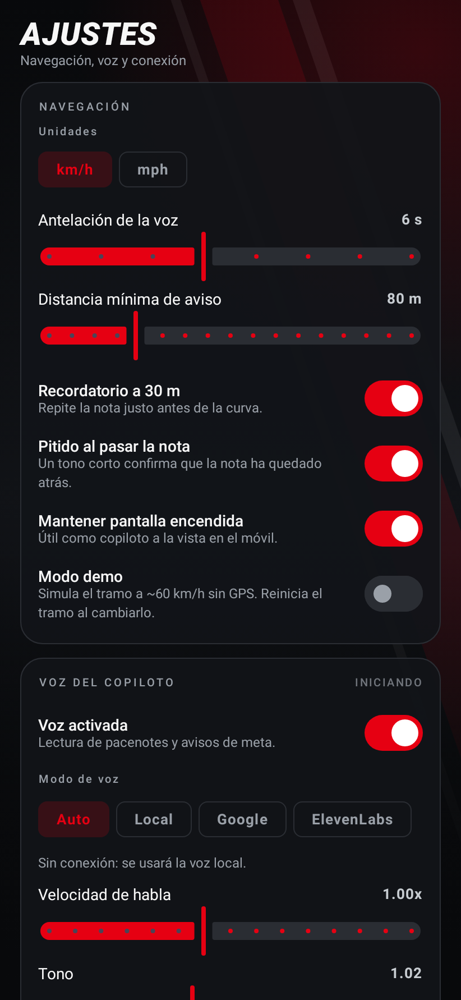
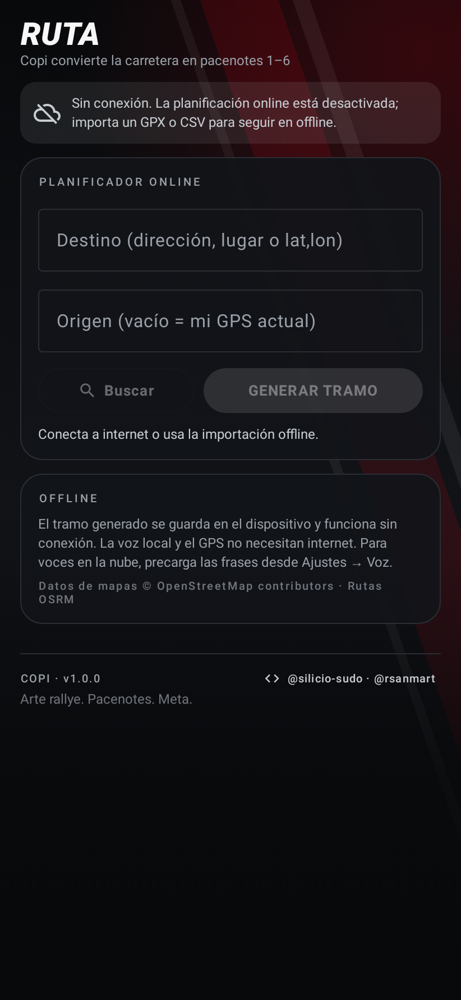

# COPI · copiloto de rally

**Copi** es un navegador de rally con GPS, roadbook y voz. Genera pacenotes
automáticamente a partir de un GPX o de una ruta online, las canta con una voz
natural y funciona sin conexión una vez descargado el tramo. Incluye una
pantalla propia para **Android Auto**.



## Dos ediciones, un mismo motor

| | **Copi Rallye** | **Copi** |
|---|---|---|
| Paquete | `com.silicio.copi.rallye` | `com.silicio.copi` |
| Diseño | Arte rallye: carbono, rojo y plata | Grafito y turquesa |
| Personalización | **LUIS FERNANDO** + GitHub **@silicio-sudo · @rsanmart** | Limpia, sin datos personales |
| APK debug | `app-rallye-debug.apk` | `app-standard-debug.apk` |

Las dos ediciones pueden instalarse a la vez porque tienen identificadores
distintos.

## Capturas

| Copi Rallye | Copi |
|---|---|
|  |  |

| Tramo y roadbook | Ajustes | Ruta online |
|---|---|---|
|  |  |  |

> Capturas renderizadas con Robolectric desde la app real. El estado sin
> conexión/GPS es el del entorno de test.

## Qué hace

- **Pacenotes automáticas**: detecta curvas, calcula el ángulo y las clasifica de
  **1 (horquilla)** a **6 (curva rápida)**. También detecta crestas si el GPX
  trae altitud.
- **Roadbook clásico**: importa CSV o exporta el tramo para compartirlo.
- **Copiloto GPS**: distancia al siguiente aviso, velocidad, media, máximo,
  cronómetro, progreso, pausa y alineación sobre el trazado.
- **Voz natural**: voces neuronales locales + Google Cloud TTS / ElevenLabs
  opcionales, con caché para repetir frases sin conexión.
- **Offline real**: GPS, motor de tramo, roadbook, voz local y HUD funcionan sin
  internet. La nube solo añade planificación y voces más naturales.
- **Android Auto**: HUD de carrera, siguiente nota, lista de próximas notas,
  controles y metadatos de navegación (Car App Library, categoría Navegación).
- **Modo demo**: simula un tramo a ~60 km/h para probar la app y Android Auto sin
  coche.

## Instalación rápida

Descarga los APK desde **[Releases](https://github.com/silicio-sudo/copi/releases/latest)**.

1. Descarga/compila el APK debug.
2. Actívalo en el móvil (origen desconocido o `adb install -r`).
3. Abre Copi, concede ubicación y elige el tramo de demostración.
4. Pulsa **INICIAR TRAMO**. Sin GPS, activa **Modo demo** en Ajustes.

```powershell
adb install -r app\build\outputs\apk\rallye\debug\app-rallye-debug.apk
adb install -r app\build\outputs\apk\standard\debug\app-standard-debug.apk
```

## Compilar

Requisitos: JDK 17 o 21, Android SDK 35, conexión a Maven/Google.

```bash
./gradlew :app:assembleRallyeDebug :app:assembleStandardDebug :app:testRallyeDebugUnitTest
```

En Windows:

```powershell
.\gradlew.bat :app:assembleRallyeDebug :app:assembleStandardDebug :app:testRallyeDebugUnitTest
```

Salidas:

- `app/build/outputs/apk/rallye/debug/app-rallye-debug.apk`
- `app/build/outputs/apk/standard/debug/app-standard-debug.apk`

El workflow de ejemplo está en `docs/github-actions-android.yml.example`.
Cópialo a `.github/workflows/android.yml` si tu token de GitHub tiene el scope
`workflow`; compila ambos APK y ejecuta los tests de núcleo.

## Android Auto: lo importante

La app implementa la **Android for Cars App Library** con categoría
`NAVIGATION`, `MapWithContentTemplate`, superficie de mapa propia, controles y
`NavigationManager`.

> **Aviso importante:** Android Auto **no muestra apps de navegación instaladas
> por ADB/Fuentes desconocidas**. Google exige que las apps de la Car App Library
> vengan de Google Play (Internal App Sharing, Internal Test Track o producción).
> El APK sirve para el móvil y para el DHU; para el coche real hay que usar una
> fuente de confianza. Copi no incluye todavía un módulo para Android Automotive
> OS (AAOS).

Guía específica y alternativas: **[Android Auto: por qué no aparece](docs/ANDROID_AUTO_SIDELOAD.md)**.

Instrucciones completas en **[MANUAL.md](MANUAL.md)**.

## Documentación

- [Manual de uso y configuración](MANUAL.md) — instalación, voz, offline/online,
  Android Auto, formatos, solución de problemas.
- [Android Auto: por qué no aparece y cómo probarlo](docs/ANDROID_AUTO_SIDELOAD.md) —
  restricción de fuentes de confianza, DHU, Internal App Sharing y alternativas.
- [Publicar en Play Console (Internal App Sharing)](docs/PLAY_INTERNAL_SHARING.md) —
  subir el AAB, testers, Play App Signing y actualizaciones.
- [Manual en PDF](docs/Copi-Manual-1.0.0.pdf) — 23 páginas A4 con portada,
  capturas y el manual completo, listo para imprimir.
- [Privacidad](PRIVACY.md).
- [Arquitectura](docs/ARQUITECTURA.md).
- Ejemplos: [CSV](docs/ejemplo-roadbook.csv) y [GPX](docs/ejemplo-tramo.gpx).

## Licencia y créditos

MIT © 2026 Luis Fernando (silicio-sudo). Mapas y geocodificación
© OpenStreetMap contributors. Rutas OSRM. Copi es un homenaje al arte rallye y
no está afiliado a Mitsubishi Motors ni a Ralliart.
